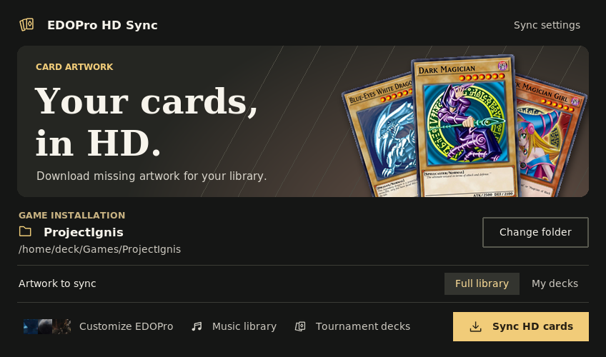

<p align="center">
  
</p>

<h1 align="center">EDOPro HD Cards Downloader</h1>

<p align="center"><b>Every card in HD. One double-click.</b></p>

<p align="center">
  
  
  
  
  
</p>

<p align="center">
  A fast, automatic HD artwork downloader for <a href="https://github.com/edo9300/edopro">EDOPro</a>.
  It scans your card databases, finds every missing image, and fetches the best available artwork —
  official, Rush Duel, anime/custom, GOAT, Pre-Errata, and alternate arts included.
</p>

<p align="center">
  
</p>

## Download

[View the skin, soundtrack and tournament screenshots](docs/gallery.md)

Download the portable app for your platform from the [Releases page](https://github.com/cntrl-alt-lenny/edopro-hd-cards/releases/latest). The Windows and Linux archives include the executable and a ReadMe. The macOS archive contains one app. Settings, artwork retry caches, optional reports and imported soundtracks live in your per-user application-data folder.

| Platform | Download | Then |
|---|---|---|
| **Windows** | [`EDOPro-HD-Sync-Windows.zip`](https://github.com/cntrl-alt-lenny/edopro-hd-cards/releases/latest) | Unzip, double-click **EDOPro-HD-Sync.exe**. If SmartScreen warns, choose **More info → Run anyway**. |
| **macOS** | [`EDOPro-HD-Sync-macOS.zip`](https://github.com/cntrl-alt-lenny/edopro-hd-cards/releases/latest) | Unzip and open **EDOPro HD Sync**. It runs natively on Apple Silicon and Intel. If macOS blocks the first launch, follow [Apple’s Open Anyway steps](https://support.apple.com/en-gb/102445). |
| **Linux** | [`EDOPro-HD-Sync-Linux.zip`](https://github.com/cntrl-alt-lenny/edopro-hd-cards/releases/latest) | Unzip, double-click **EDOPro-HD-Sync** (or run `./EDOPro-HD-Sync`). |

**It finds your EDOPro folder for you.** The window shows the current installation. **Change folder** lists nearby copies, including portable installations, and lets you browse to another location. The app remembers your choice.

## Features

- **One file, nothing to install** — unzip the app anywhere and open it. Settings and retry caches live in your user profile.
- **Finds your EDOPro folder** — it checks the usual install locations and shows you what it found; you just confirm it.
- **One simple window** — choose Full library or My decks, press **Sync HD cards**, and watch the live progress and results right in the window. Same experience on Windows, macOS, and Linux.
- **Every card type covered** — official, Rush Duel, and anime/custom cards are all fetched directly by the same IDs EDOPro uses.
- **Field Spell playmat art** — the cropped artwork EDOPro displays on the board is downloaded into `pics/field/` automatically.
- **GOAT / Pre-Errata artwork choice** uses the base card’s sharp artwork by default. Turn off *HD GOAT / Pre-Errata artwork* (or use `--original-text`) for the card’s historical wording at lower resolution. Changing this setting refreshes affected cards once replacements download successfully.
- **Deck-first sync** — choose *My decks* (or use `--my-decks`) and a fresh install is playable in minutes instead of hours.
- **Coverage at a glance** — *Sync settings → Show coverage* (or `--stats`) tells you how complete your artwork is without downloading a thing.
- **Repair mode** — tick *Repair broken images* (or use `--repair`) to find and re-fetch corrupt or half-downloaded files.
- **Customize EDOPro** previews Abyss, Moon, Nebula, and Ristretto in the game menu, deck editor, and duel field. Set your sleeve and your opponent’s independently using the original Vortex and 1998 OCG artwork. Compare the original duel field with **Highlight the turn player** to see whose turn it is at a glance. Preview the duel sound effects, then close EDOPro to apply your changes. Restoring the previous skin also restores its fonts.
- **Music library** has separate selections for the deck editor and regular duels. Browse 25 game covers, preview and seek through a track, then apply it to the selected installation. Dates refer to the pictured edition. Restore the previous playlist at any time. The gallery spans the *Power of Chaos* trilogy, *World Championship*, *Tag Force*, and *Legacy of the Duelist*. It uses audio already in EDOPro and recordings you import. **Manage library** can read original *Power of Chaos* audio and import a personal soundtrack folder copied from another device. If game music is muted, use **Enable game music** after closing EDOPro. This keeps your volume setting. [Cover art from LaunchBox Games Database](https://gamesdb.launchbox-app.com/)
- **Tournament decks** lets you browse results by format or event, preview published lists, and save one or more directly into EDOPro’s `deck` folder. After importing, you can sync HD artwork just for those decks. Existing edits are preserved. Event standings, card lists, and deck downloads come from [Format Library](https://formatlibrary.com/events).
- **Update notices** — it tells you when a newer version is out; download it and replace the one file.
- **Safe and resumable** — verified downloads, a 14-day failure cache so known-missing cards aren't hammered, and optional timestamped sync reports.

The importer keeps supported passcodes, counts, and section order. If an event uses an alternate printing absent from your installation, it checks the published card details against your local databases before using a supported printing. The app reports card IDs it could not resolve. In Goat events, **Use installed GOAT card versions** saves a separate historical copy and lets you review the matched cards. To host with this copy, set **Forbidden List** to **2005.4 GOAT**, **Rule** to **GOAT**, and **Allowed Cards** to **Anything goes**. Keep both deck checks enabled. The whitelist enforces the format while allowing EDOPro’s historical card IDs.

## How it works

0. **Find** — looks for your EDOPro folder in the places it's normally installed, then shows it for you to confirm.
1. **Scan** — reads every `.cdb` card database in your EDOPro folder (root, `expansions/`, and repository deltas).
2. **Diff** — compares the cards your installed databases know about against the images already in `pics/` and only queues what's missing.
3. **Fetch** — 50 async workers try each card on [YGOProDeck](https://ygoprodeck.com), with a waterfall for tricky cases: manual overrides, GOAT / Pre-Errata suffix matching, an ID-offset fallback, and ProjectIgnis's own image server as the final backup (so even brand-new Rush Duel sets download).
4. **Extras** — Field Spell playmat art lands in `pics/field/`, definitive misses are cached for 14 days, and a sync report can be saved when it's done.

## CLI reference

The packaged app needs no flags — the options window covers the common choices. Power users get the full set:

<details>
<summary><b>All flags</b></summary>

| Flag | What it does |
|---|---|
| `--force` / `--no-force` | Re-download **all** images for a full refresh (default: only missing). |
| `--dry-run` | Preview what would be downloaded without downloading. |
| `--my-decks` | Only sync cards used in your EDOPro deck folder (much faster). |
| `--deck PATH` | Only sync cards in one `.ydk` file (repeat to combine decks). |
| `--decks-folder PATH` | Only sync cards in every `.ydk` inside a folder. |
| `--stats` | Show artwork coverage and disk usage, then exit. |
| `--repair` | Re-download images that are missing, corrupt, or not valid JPEGs. |
| `--field-art` / `--no-field-art` | Field Spell playmat art into `pics/field/` (default: on). |
| `--original-text` / `--no-original-text` | GOAT/Pre-Errata cards use their **own** artwork instead of the modern reprint's — era-correct wording, lower resolution (default: off). |
| `--textures` / `--no-textures` | Also download the curated texture pack into `textures/`. |
| `--textures-pack NAME` | Pick a specific texture pack. |
| `--gui` / `--no-gui` | Force or skip the tick-box options window. |
| `--recheck-missing` | Retry cards in the failure cache (useful after new sets hit YGOProDeck). |
| `--prune` | After the sync, delete images whose IDs are no longer in any database. |
| `--edopro-path PATH` | Point at a specific EDOPro/ProjectIgnis folder. |
| `--save-report` / `--no-save-report` | Write a timestamped `.txt` sync report. |
| `--quiet` | Minimal output — just the progress bar and summary. |
| `--concurrency N` | Max simultaneous downloads (default: 50). |
| `--max-retries N` | Retry failed downloads N times after the initial attempt (default: 3). |
| `--timeout N` | HTTP timeout in seconds (default: 30). |
| `--config PATH` | Use a custom config file. |
| `--generate-config` | Write a default `config.json` and exit. |
| `--health-check` | Run quick offline sanity checks and exit. |
| `--no-pause` | Windows packaged builds: close immediately instead of waiting for Enter. |

</details>

## From source

This checkout opens **EDOPro Studio** with `python main.py --gui`. HD Cards runs inside the resizable sidebar window. The original customization, music and tournament tools are available with `python main.py --legacy-gui` while their Studio pages are being ported. See the [Studio developer guide](studio/README.md) for local demos, tests and screenshots.

```bash
git clone https://github.com/cntrl-alt-lenny/edopro-hd-cards.git
cd edopro-hd-cards
pip install -r requirements.txt

python main.py                 # normal sync
python main.py --my-decks      # deck-first sync
python main.py --health-check  # quick offline sanity check
```

For networks that require a proxy, the app honors `HTTP_PROXY`, `HTTPS_PROXY`,
and `NO_PROXY`. If your network uses a private certificate authority, point
`EDOPRO_CA_BUNDLE` at a PEM bundle. `--config PATH` remains available when you
want all settings and caches beside a portable copy of the script.

## Contributing

Contributions are welcome — open an issue or send a pull request. Please run `python main.py --health-check` and the test suite before submitting.

## Credits

- Original concept: [EDOPro-Hd-Downloader](https://github.com/NiiMiyo/EDOPro-Hd-Downloader) by NiiMiyo
- Card artwork hosted by [YGOProDeck](https://ygoprodeck.com) and [ProjectIgnis](https://github.com/ProjectIgnis)
- Licensed under the [MIT License](LICENSE)
