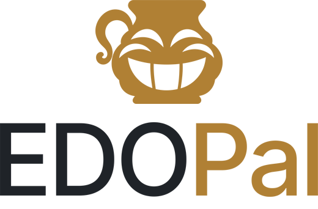

  <picture>
    <source media="(prefers-color-scheme: dark)" srcset="docs/readme/logo-dark.png">
    
  </picture>

  <b>The companion app for EDOPro.</b> 
  HD card art, themes, music and every classic format, in one place.

  
  
  
  

  
  
  

## Features

- **HD Cards** · Syncs high-resolution art for your cards and Field Spells.
- **Themes** · Skins, card backs and icon packs, previewed before you apply.
- **Music** · Soundtracks from the Yu-Gi-Oh! games, set per menu and duel.
- **Formats** · All 128 Format Library formats, with banlists and tournament decks.
- **Plugins** · Extend EDOPal. Deck Tracker is coming soon.

<b>First launch</b>

 

- **Windows** · Unzip and run the `.exe`.
- **macOS** · Unzip and open the app.
- **Linux / Steam Deck** · Use the x86-64 build. On Deck, run it from Desktop Mode.

Card data and art from <a href="https://ygoprodeck.com/">YGOPRODeck</a> and <a href="https://projectignis.github.io/">Project Ignis</a>. Formats from <a href="https://formatlibrary.com/">Format Library</a>. EDOPal is a fan project and is not affiliated with Konami.
