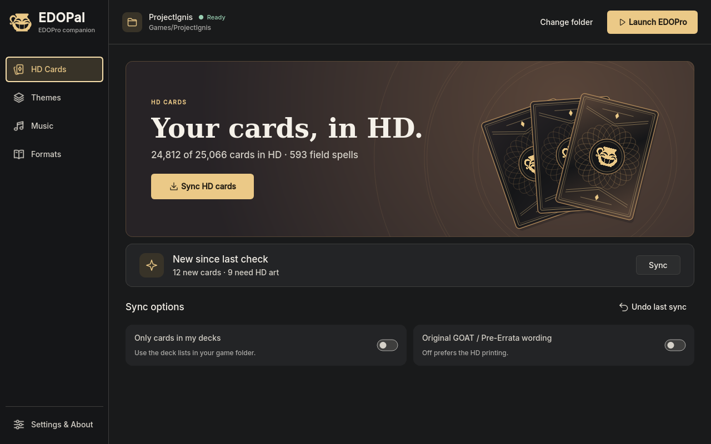

  <picture>
    <source media="(prefers-color-scheme: dark)" srcset="src/edopal/assets/logo-mark.png?raw=true">
    
  </picture>

<h1 align="center">EDOPal</h1>

<strong>If you have EDOPro, get EDOPal.</strong>

  
  
  
  
  

## Install in 3 steps

Open EDOPro once, let its card databases finish downloading, then close the game. The downloads below are for the upcoming v6 stable release. [Browse published releases](https://github.com/cntrl-alt-lenny/edopal/releases)

| 1. Download for your system | 2. Open EDOPal | 3. Select your EDOPro folder |
| --- | --- | --- |
| [Windows x64 · ZIP][win] | Choose **Extract All**, then open `EDOPal.exe` in the extracted folder. | Choose the game folder containing `config` and `pics`. |
| [macOS 15+ · Intel & Apple silicon ZIP][mac] | Unzip, move `EDOPal.app` to Applications and open it. | Choose your EDOPro data folder. |
| [Linux x86-64 / Steam Deck · AppImage][linux] | Mark the AppImage executable and open it. On Deck, use Desktop Mode. Or extract the [portable tar.gz][tar] and run `./EDOPal` from its folder. | Choose the native or Proton copy you play. |

In **HD Cards**, choose **Sync HD cards**, then **Launch EDOPro** to see your cards in game.

If macOS blocks the unsigned app on first open and you trust your download, go to **System Settings → Privacy & Security → Open Anyway**. [Apple’s guide](https://support.apple.com/en-us/102445)

## Features

| HD Cards | Themes & card backs |
| --- | --- |
| Sync card faces and Field Spell art. See which cards still need artwork after a game update. | Preview Abyss, Nebula and Moon in the menu, deck editor and duel. Pick a card back for each player. |
| **Music** | **Formats** |
| Listen to a soundtrack, then assign tracks to the menu, deck editor, duel, victory or defeat. | Browse tournament decks by era, install the banlist and copy host settings for formats like Goat, Edison and HAT. |

## FAQ

**Where do the files go?** EDOPal puts art in `pics/`, themes in `skin/`, music in `sound/BGM/` and decks in `deck/` under your selected game folder. Downloaded packs stay in your user cache. [Pack layout](docs/packs.md)

**Can I undo a change?** Use **Undo** for the last change that feature made to the selected installation. Files you edited afterward are left in place.

**Is it safe to apply changes while playing?** Close EDOPro first. EDOPal checks whether the game is running before writing and verifies downloaded packs against their SHA-256 checksums.

From a Linux checkout, run `./tools/try-release.sh` to try the latest release in a temporary folder, or `./tools/try-local.sh` to build and launch your working copy. [Release launcher](tools/try-release.sh) · [Local launcher](tools/try-local.sh) · [Build requirements](docs/release.md)

[Release notes](CHANGELOG.md) · [Report a bug or contribute an idea](https://github.com/cntrl-alt-lenny/edopal/issues)

## Credits & license

- EDOPro and card artwork · [Project Ignis](https://projectignis.github.io/) · [YGOPRODeck](https://ygoprodeck.com/)
- Tournament results and deck lists · [Format Library](https://formatlibrary.com/)
- Soundtrack cover artwork · [LaunchBox Games Database](https://gamesdb.launchbox-app.com/)

EDOPal is an unofficial companion. Its source code is MIT-licensed. Media credits accompany each pack. [MIT license](LICENSE) · [Inter font license](src/edopal/assets/fonts/Inter-OFL.txt)

[win]: https://github.com/cntrl-alt-lenny/edopal/releases/latest/download/EDOPal-windows-x86_64.zip
[mac]: https://github.com/cntrl-alt-lenny/edopal/releases/latest/download/EDOPal-macos-universal2.zip
[linux]: https://github.com/cntrl-alt-lenny/edopal/releases/latest/download/EDOPal-linux-x86_64.AppImage
[tar]: https://github.com/cntrl-alt-lenny/edopal/releases/latest/download/EDOPal-linux-x86_64.tar.gz
