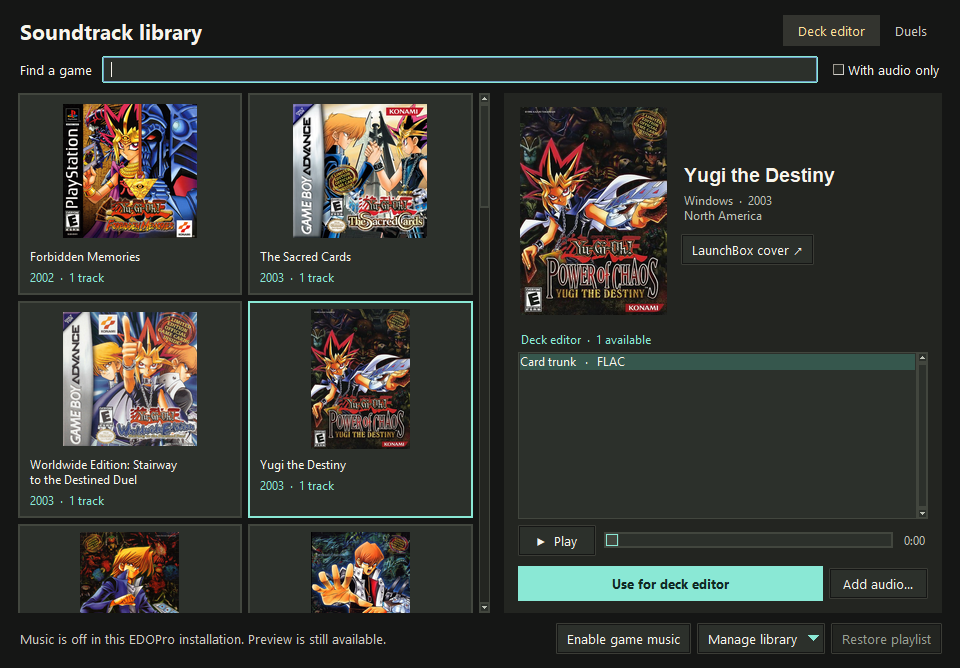
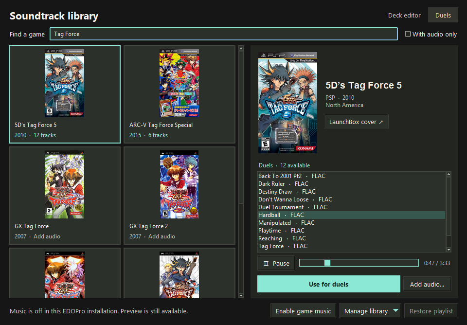
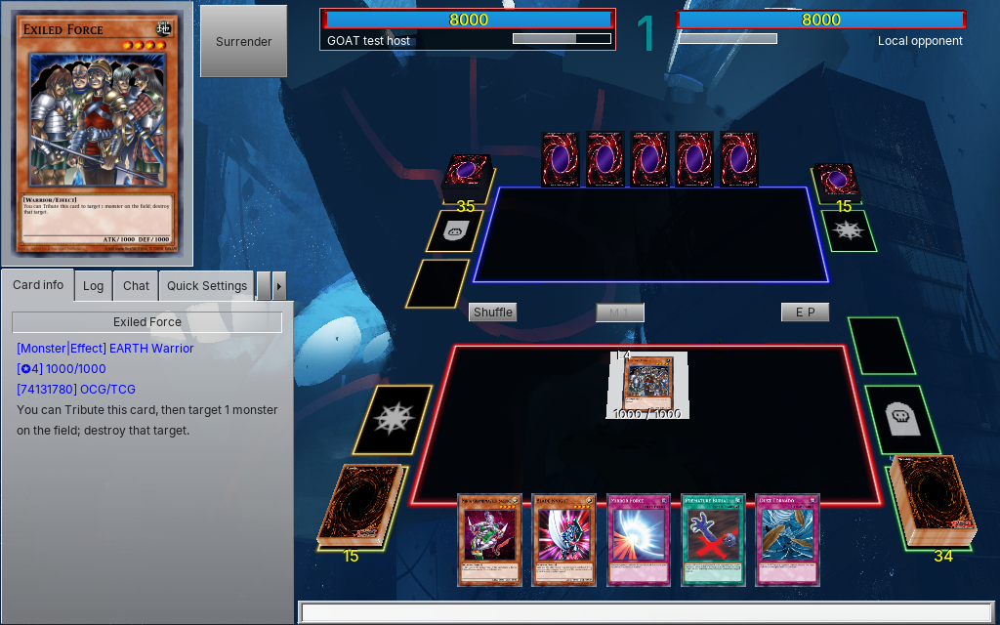

# Screenshot gallery

[Artwork home](../assets/app-window.png) · [Deck-editor music](screenshots/Soundtracks-deck.png) · [Duel music](screenshots/Soundtracks-duels.png) · [An imported tournament deck in a Goat duel](screenshots/GOAT-LAN-duel.png)

Choose a scene to open the full-size EDOPro capture. The turn highlight is optional for every skin.

| Skin | Menu | Deck editor | Duel field | Turn highlight |
|---|---|---|---|---|
| Abyss | [Menu](../assets/window/gallery/large/abyss-menu.png) | [Deck editor](../assets/window/gallery/large/abyss-deck.png) | [Duel field](../assets/window/gallery/large/abyss-duel.png) | [Turn highlight](../assets/window/gallery/large/abyss-turn.png) |
| Moon | [Menu](../assets/window/gallery/large/moon-menu.png) | [Deck editor](../assets/window/gallery/large/moon-deck.png) | [Duel field](../assets/window/gallery/large/moon-duel.png) | [Turn highlight](../assets/window/gallery/large/moon-turn.png) |
| Nebula | [Menu](../assets/window/gallery/large/nebula-menu.png) | [Deck editor](../assets/window/gallery/large/nebula-deck.png) | [Duel field](../assets/window/gallery/large/nebula-duel.png) | [Turn highlight](../assets/window/gallery/large/nebula-turn.png) |
| Ristretto | [Menu](../assets/window/gallery/large/ristretto-menu.png) | [Deck editor](../assets/window/gallery/large/ristretto-deck.png) | [Duel field](../assets/window/gallery/large/ristretto-duel.png) | [Turn highlight](../assets/window/gallery/large/ristretto-turn.png) |

## Soundtrack library

## Tournament decks

An imported Goat Format Championship winning deck in an EDOPro duel with both deck checks enabled.

